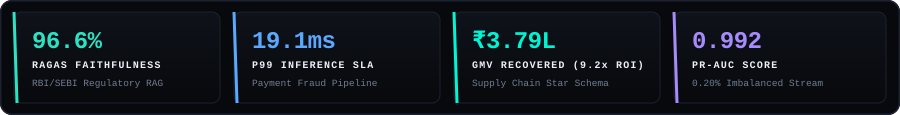
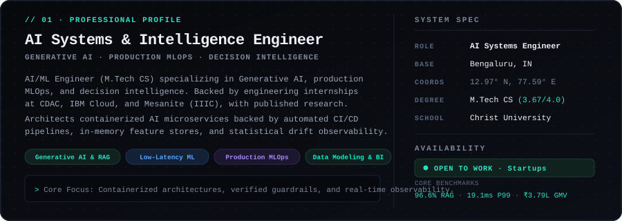
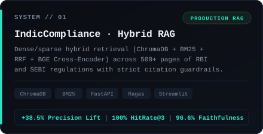
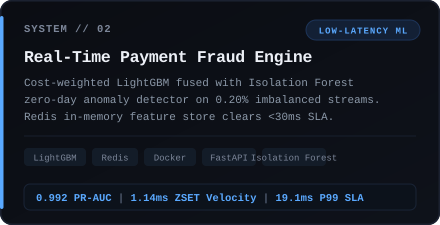
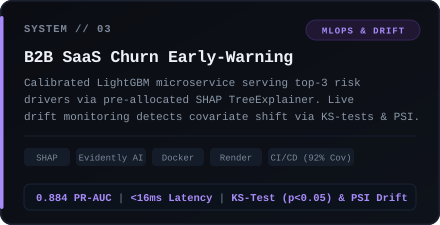
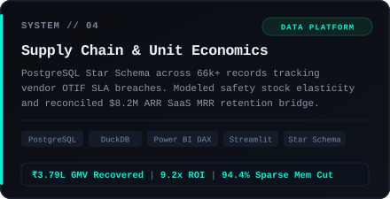
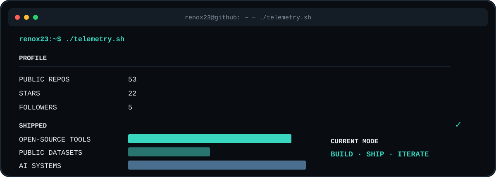

<div align="center">



<br/>

<a href="https://renox23-portfolio.vercel.app/"></a>&nbsp;<a href="https://www.linkedin.com/in/renoldstephen/"></a>&nbsp;<a href="mailto:renoldstephen23@gmail.com"></a>&nbsp;<a href="https://github.com/RenoX23"></a>

<br/><br/>



</div>

<br/>

---

### `01 // IDENTITY · PROFESSIONAL OVERVIEW`

<div align="center">



</div>

<details>
<summary><b>▸ View Accessible Bio &amp; Systems Overview</b></summary>
<br/>

AI/ML Engineer (M.Tech CS) specializing in Generative AI, production MLOps, and scalable decision intelligence. Backed by engineering internships at CDAC, IBM Cloud, and Mesanite (IIIC), with published computer vision research and a registered copyright with the Government of India.

Architects containerized AI microservices backed by automated CI/CD pipelines, in-memory feature stores, and statistical observability (KS-tests, PSI) to deliver reliable, SLA-bound production systems.

* **Core Competencies**: Agentic AI Workflows · Hybrid RAG (BM25 + Cross-Encoders) · Sub-20ms ML Inference · Real-Time Drift Observability · Star Schema Data Modeling.
* **Engineering Standard**: *Moving beyond isolated notebook experiments into containerized, observable, and SLA-bound production systems.*

</details>

---

### `02 // CORE DOMAINS (WHAT I BUILD)`

<div align="center">

<table>
<tr>
<td width="25%" valign="top">

#### `[01]` AGENTIC AI &amp; RAG
Dense/sparse hybrid retrieval (ChromaDB + BM25 + RRF), BGE cross-encoders, citation guardrails, and automated evaluation using Ragas.

</td>
<td width="25%" valign="top">

#### `[02]` LOW-LATENCY ML
Cost-weighted gradient boosting fused with zero-day anomaly detection, clearing sub-20ms P99 SLAs with zero temporal leakage.

</td>
<td width="25%" valign="top">

#### `[03]` PRODUCTION MLOPS
Covariate shift detection via KS-tests and Population Stability Index (PSI), pre-allocated SHAP microservices, and CI/CD pipelines.

</td>
<td width="25%" valign="top">

#### `[04]` DATA PLATFORMS
In-memory Redis feature stores (`ZSET` velocity counters), analytical data marts (DuckDB), and PostgreSQL Star Schemas with CTE window functions.

</td>
</tr>
</table>

</div>

---

### `03 // FLAGSHIP PRODUCTION SYSTEMS`

<table width="100%">
<tr>
<td width="50%" valign="top">
  <a href="https://github.com/RenoX23">
    
  </a>
</td>
<td width="50%" valign="top">
  <a href="https://github.com/RenoX23">
    
  </a>
</td>
</tr>
<tr>
<td width="50%" valign="top">
  <a href="https://github.com/RenoX23">
    
  </a>
</td>
<td width="50%" valign="top">
  <a href="https://github.com/RenoX23">
    
  </a>
</td>
</tr>
</table>

<details>
<summary><b>▸ Open-Source Developer Tooling &amp; Infrastructure</b></summary>
<br/>

<table>
<tr>
<td width="50%" valign="top">

#### 🧩 [AI Agent Workflow Builder](https://github.com/RenoX23/ai-agent-workflow-builder)
Visual DAG orchestration for multi-step AI agent workflows. Composes, inspects, and debugs agentic execution traces without black-box abstractions.  
`TypeScript` `AI Agents` `Workflow Orchestration`

</td>
<td width="50%" valign="top">

#### 🔨 [DataForge](https://github.com/RenoX23/DataForge)
Controllable synthetic dataset generation engine designed around schema constraints and realistic distributions rather than toy random noise.  
`Python` `Data Engineering` `Synthetic Data`

</td>
</tr>
<tr>
<td width="50%" valign="top">

#### 🧠 [GenAI Data Quality Explainer](https://github.com/RenoX23/genai-dq-explainer)
Automated root-cause diagnostic engine that translates data pipeline anomalies and expectation violations into structured, actionable remediation steps.  
`Python` `GenAI` `Data Observability`

</td>
<td width="50%" valign="top">

#### 🔁 [GitOps &amp; MLOps CI/CD Control Plane](https://github.com/RenoX23/devops-gitops-ci)
Production-grade deployment pipeline managing containerized ML workloads across Kubernetes with automated Canary rollouts and Git as the single source of truth.  
`Kubernetes` `GitOps` `ArgoCD` `MLOps`

</td>
</tr>
</table>

</details>

---

### `04 // PRODUCTION TECH STACK`

<table width="100%">
<tr>
<td width="50%" valign="top">

#### `[01]` AI, LLMS &amp; INFERENCE
<div align="left">
  
</div>

<br/>


<sub>Dense/sparse hybrid retrieval (BM25 + BGE), Ragas faithfulness guardrails, Groq 4.0ms LLaMA inference, cost-weighted LightGBM.</sub>

</td>
<td width="50%" valign="top">

#### `[02]` DATA &amp; FEATURE STORES
<div align="left">
  
</div>

<br/>


<sub>In-memory feature velocity (1.14ms ZSET), DuckDB analytical data marts, Star Schema data modeling, sparse matrix compression.</sub>

</td>
</tr>
<tr>
<td width="50%" valign="top">

#### `[03]` MLOPS &amp; OBSERVABILITY
<div align="left">
  
</div>

<br/>


<sub>Covariate shift drift detection via KS-tests &amp; PSI, pre-allocated SHAP TreeExplainer microservices, cluster health observability.</sub>

</td>
<td width="50%" valign="top">

#### `[04]` CLOUD, INFRASTRUCTURE &amp; BI
<div align="left">
  
</div>

<br/>


<sub>Autoscaling pod clusters (2 → 8 pods, p95 &lt; 300ms), Terraform IaC pipelines, executive Power BI and Streamlit dashboards.</sub>

</td>
</tr>
</table>

---

### `05 // RESEARCH, CREDENTIALS & PEDIGREE`

<table>
<tr>
<td width="50%" valign="top">

#### 💼 Engineering Experience

* **Mesanite Software Solutions (IIIC, Bengaluru)**  
  *NLP Research Intern* `[May 2026 – Jun 2026]`  
  • Developed **GapIQ**: Hybrid NLP matching engine fusing 5D semantic scoring with Groq LLaMA-3.3 (**4.0ms inference latency**).  
  • Benchmarked 5 NLP architectures: **+317% F1 lift over TF-IDF** (F1=0.547, $p < 0.05$).

* **CDAC (Centre for Development of Advanced Computing, Bengaluru)**  
  *IT &amp; DevOps Intern* `[Dec 2025 – Jan 2026]`  
  • Provisioned AWS infrastructure via Terraform; configured Kubernetes Horizontal Pod Autoscaling (HPA scaling 2 → 8 pods).  
  • Sustained **p95 latency < 300ms** under burst workloads with Jenkins CI/CD & Prometheus alerts.

* **IBM Cloud, Bengaluru**  
  *Cloud Intern* `[Oct 2024 – Feb 2025]`  
  • Orchestrated containerized deployment pipelines on IBM Kubernetes Service (IKS).  
  • Configured Prometheus & Grafana dashboards for real-time node health & cluster telemetry.

</td>

<td width="50%" valign="top">

#### 📜 Intellectual Property &amp; Education

* **Published Research Paper**  
  *Computer Vision & Assistive Navigation*  
  YOLOv5 + Raspberry Pi Edge Assistive Navigation for Visually Impaired.

* **Registered Intellectual Property**  
  Co-authored **1 Copyright Registered** with the Copyright Office, Government of India.

* **Open Data & Community**  
  • Published **5+ Public Kaggle Datasets** for ML, analytics, and research.  
  • **4+ Open-Source Tools** released on GitHub.  
  • **Microsoft Learn Student Ambassador (MLSA)**.

* **Certifications**  
  • Microsoft Certified: Azure Fundamentals (AZ-900)  
  • Generative AI — Google Skill Builder  
  • Exploratory Data Analysis — Accenture

* **Academic Background**  
  • **M.Tech in Computer Science** `[2025 – 2027]`  
    *Christ University, Bengaluru* — **CGPA: 3.67 / 4.0**  
  • **B.Tech in Information Science &amp; Engineering** `[2021 – 2025]`  
    *Cambridge Institute of Technology, Bengaluru* — **CGPA: 8.36 / 10.0**

</td>
</tr>
</table>

---

### `06 // LIVE TELEMETRY · REPO ACTIVITY`

<div align="center">



<br/><br/>

<a href="https://github.com/RenoX23"></a>&nbsp;<a href="https://github.com/RenoX23?tab=stars"></a>&nbsp;<a href="https://komarev.com/ghpvc/?username=RenoX23"></a>

</div>

---

### `07 // DISPATCH · DIRECT CHANNELS`

<div align="center">

```text
> "The hard part of AI isn't the prototype — it's the system:
   the latency bounds, the citation guardrails, the data integrity,
   and the observability that keeps it working in production."

> let's build something useful together.
```

<br/>

<a href="mailto:renoldstephen@gmail.com"></a>&nbsp;&nbsp;<a href="https://www.linkedin.com/in/renoldstephen/"></a>&nbsp;&nbsp;<a href="https://renox23-portfolio.vercel.app/"></a>

<br/><br/>

<sub>Engineered with precision · Hosted on <a href="https://github.com/RenoX23">GitHub</a> · Automated continuous integration</sub>

</div>
